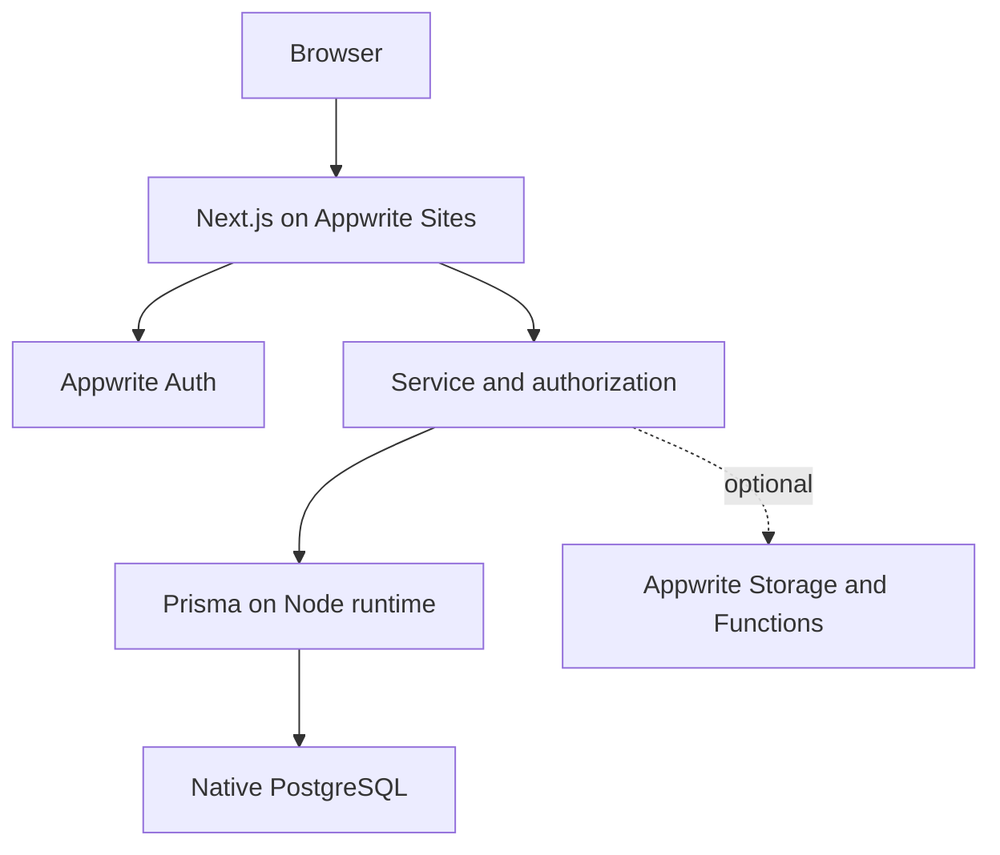

# System architecture — target design
สถานะ: ข้อเสนอที่ใช้วาง foundation; ยังไม่มี deployment ที่ยืนยันแล้ว

M1 local implementation (2026-11-13): หน้า static ภาษาไทย, route handlers `/api/health` และ `/api/ready`,
`src/services/readiness.ts` และ server-only config boundaries ใน `src/lib/env`, `src/lib/auth`, `src/lib/db`
Prisma 7 schema/config มีจริงแต่ยังไม่มี models; ยังไม่ instantiate Auth/DB client หรือเปิด connection
ขั้นตอน protected request flow ด้านล่างเป็นเป้าหมาย M2/M3 ไม่ใช่พฤติกรรมที่มีแล้ว

## การแบ่งความรับผิดชอบ
| ส่วน | หน้าที่ |
|---|---|
| Next.js pages/components | แสดง UI และสถานะ loading/empty/error |
| Route handlers/server actions | ตรวจ input, session, permission และแปลงผลลัพธ์ |
| services | กฎธุรกิจและ transaction; ใช้ซ้ำได้และทดสอบได้ |
| lib/auth | สร้าง session client ต่อ request และตรวจ identity |
| lib/db | Prisma adapter/client ฝั่ง server และจัดการ pool |
| PostgreSQL | ข้อมูล relational และข้อจำกัดความถูกต้อง |
| Appwrite Auth | credentials, session, external identity |

## Request flow สำหรับข้อมูลที่ป้องกัน
1. Browser ส่ง cookie ตาม policy ไป Next.js
2. Server ตรวจ session กับ Appwrite ด้วย session client ของ request นั้น
3. อ่าน local identity mapping; ไม่มีบัญชีที่ provision ไว้ให้ปฏิเสธ ไม่ auto-promote
4. ตรวจ action permission และขอบเขต record จากข้อมูลฝั่ง server
5. เรียก Prisma พร้อม filter ที่จำกัดสิทธิ์; write หลายขั้นใช้ transaction
6. ส่งเฉพาะ fields ที่อนุญาต และบันทึก audit ที่เหมาะสมโดยไม่เก็บ secrets
การซ่อนปุ่มหรือ redirect หน้า login ไม่ทดแทนข้อ 2–4

## โครงสร้างเป้าหมายหลัง Codex scaffold
- src/app/: หน้าเว็บ, layouts, route handlers
- src/components/: UI
- src/lib/auth/, src/lib/db/, src/lib/env/: infrastructure ฝั่ง server
- src/services/: application use cases
- src/types/: สัญญาข้อมูลร่วมที่ไม่ผูกกับ secrets
- prisma/: schema และ migrations หลังตัดสินใจรุ่น Prisma
- tests/: unit, integration, e2e แยกตามสิ่งที่ต้องเชื่อมจริง
- docs/, prompts/: บริบทและการส่งงาน
ไม่สร้างไฟล์เปล่าทุกชั้นถ้ายังไม่มีหน้าที่ใช้งาน

## Runtime และ config
ใช้ Node runtime สำหรับเส้นทาง PostgreSQL ตาม adapter ที่ทดสอบแล้ว
สร้าง database client แบบ reuse ที่เหมาะกับ runtime; ห้ามสร้าง pool ใหม่ต่อ query หรือแชร์ mutable Appwrite session client ข้ามผู้ใช้
อย่าเรียก Auth/DB ตอน static generation ของหน้าเริ่มต้น ให้ protected content โหลดใน request ที่เหมาะสม
แยก configuration validation ของหน้า shell, Auth และ DB เพื่อให้การขาด credentials ไม่ทำให้ M1 ทั้งหมดพัง
Build ห้ามต้องเปิด connection จริงถ้าไม่ได้ระบุเป็น integration stage
Dev, staging และ production ต้องใช้ credentials/ข้อมูลแยกกันเมื่อเริ่มเชื่อมจริง
